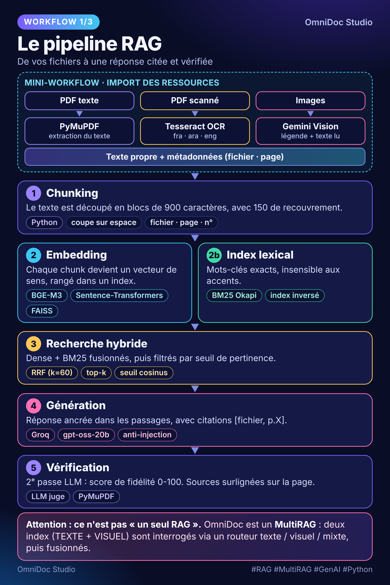
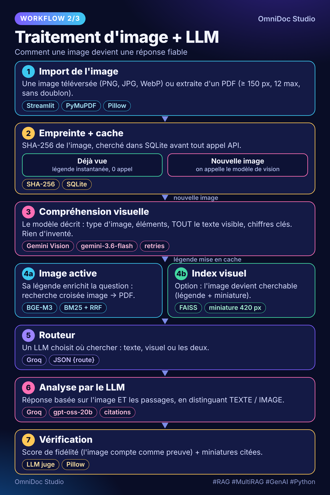

# OmniDoc Studio

🇬🇧 [English version](README.md) · [Architecture](docs/ARCHITECTURE.md) · [Contribuer](CONTRIBUTING.md)

Assistant documentaire **MultiRAG** : dialoguez avec vos PDF *et* vos images, puis éditez vos PDF en langage naturel.
Interface **Streamlit**.


## Fonctionnalités

| Idée | Description |
|---|---|
| **MultiRAG** | Deux index : TEXTE (PDF + OCR) et VISUEL (légendes des images par Gemini Vision). |
| **Recherche hybride** | Dense (bge-m3 + FAISS) + lexicale (BM25 insensible aux accents) fusionnées par *Reciprocal Rank Fusion*. |
| **Routeur de requêtes** | Un LLM décide : texte, visuel ou mixte, avant la recherche. |
| **Requête image → PDF** | Une image « active » enrichit la recherche dans les PDF (recherche cross-modale). |
| **Vérification de fidélité** | Une seconde passe LLM note si la réponse est soutenue par les sources (et l'image active). |
| **Citations visuelles** | Les passages cités sont surlignés sur la page PDF d'origine. |
| **Éditeur PDF en langage naturel** | « supprime les pages 2 à 4 », « caviarde Dupont », « filigrane BROUILLON » → plan JSON validé et modifiable, puis exécution (PyMuPDF). |
| **Caviardage RGPD** | Détection e-mail / IBAN / téléphone / CIN et suppression réelle du texte sous le masque noir. |
| **Fusion, insights, export** | Fusion de PDF, résumé intelligent, export `.txt` de la conversation. |

## Workflows

Trois schémas lisibles (1080×1620, prêts pour un post LinkedIn) :

| 1 · Pipeline RAG | 2 · Image + LLM | 3 · Projet complet |
|---|---|---|
|  |  |  |

Pour les régénérer après modification : `pip install playwright && playwright install chromium && python tools/render_workflows.py`.

## Interface

- **Thèmes** : Sombre, Clair, Soft (tons chauds et reposants), au choix dans la barre latérale ; le choix est gardé dans l'URL (`?theme=soft`).
- **Nouvelle conversation** : bouton en haut de la barre latérale (invités compris) ; efface la discussion et garde vos sources et l'index.
- **Export** : la conversation s'exporte en texte brut `.txt` (sources et score de fidélité inclus).

## Installation

```bash
python -m venv .venv && source .venv/bin/activate      # Windows : .venv\Scripts\activate
pip install -r requirements.txt
cp .streamlit/secrets.toml.example .streamlit/secrets.toml   # puis ajoutez vos clés
streamlit run app.py
```

Les clés et paramètres sont lus dans `st.secrets` **ou** dans l'environnement (voir `.env.example` pour la liste complète :
modèles, taille des chunks, seuils, timeouts…).

OCR (optionnel mais recommandé pour les PDF scannés) : installez **Tesseract** avec les langues `fra`, `ara`, `eng`.
Chemin personnalisé : variable d'environnement `TESSERACT_CMD`.

### Docker

```bash
docker build -t omnidoc-studio .
docker run -p 8501:8501 -v omnidoc-data:/data \
  -e GROQ_API_KEY=... -e GEMINI_API_KEY=... omnidoc-studio
```

## Tests

```bash
make test      # ou : python -m unittest discover -s tests -t . -v
```
Les tests tournent hors-ligne (faux LLM, faux embedder). Ceux de l'éditeur PDF nécessitent PyMuPDF et sont ignorés s'il est absent.

## Structure

```
app.py                interface Streamlit (3 onglets : Assistant, Éditeur PDF, Insights)
core/config.py        paramètres, clés, chemins, logging
core/prompts.py       tous les prompts
core/i18n.py          textes de l'interface (fr / en / ar)
core/extract.py       texte PDF, OCR de secours, images intégrées
core/retrieval.py     chunking, BM25, dense (FAISS/NumPy), RRF, MultiRAG
core/llm.py           Gemini (vision) + Groq (routage, réponse, vérification, commandes d'édition)
core/pipeline.py      ask() : route → recherche → réponse → vérification ; légendes d'images avec cache
core/plan.py          validation du plan d'édition (schéma, types)
core/pii.py           détection de données personnelles
core/editor.py        opérations PDF, caviardage, rendu des citations
core/theme.py         thèmes sombre / clair / soft (CSS)
core/export.py        export .txt de la conversation
core/db.py            comptes (PBKDF2), historique, cache de légendes (SQLite)
tests/                tests hors-ligne
docs/                 architecture, 3 workflows (PNG + sources HTML), notes d'ingénierie ; tools/render_workflows.py les génère
assets/               logo, avatar du chat, visuel d'origine
```

## Déploiement

GitHub héberge le **code** ; l'application Streamlit tourne ailleurs (GitHub Pages ne peut pas exécuter Python).

- **Streamlit Community Cloud** (gratuit) : *New app* → dépôt, branche `main`, fichier `app.py`. Collez vos clés dans *Settings → Secrets*
  (`GROQ_API_KEY`, `GEMINI_API_KEY`). `packages.txt` installe Tesseract (OCR) automatiquement.
- **Docker** : voir ci-dessus (Hugging Face Spaces, Render, Fly.io, VPS…).

Ne commitez jamais `.streamlit/secrets.toml` ni `.env` (déjà dans `.gitignore`).

## Limites connues
- Les images intégrées sont plafonnées à 12 par PDF (`MAX_PDF_IMAGES`) pour maîtriser les appels API.
- Le caviardage PII est basé sur des expressions régulières : relisez toujours le résultat avant diffusion.
- L'index de recherche est reconstruit à chaque « Construire le MultiRAG » (il n'est pas persisté sur disque).
- Le filigrane utilise la police par défaut de PyMuPDF : les textes non latins (arabe) ne s'y affichent pas correctement.

## Licence

MIT — voir `LICENSE`.
