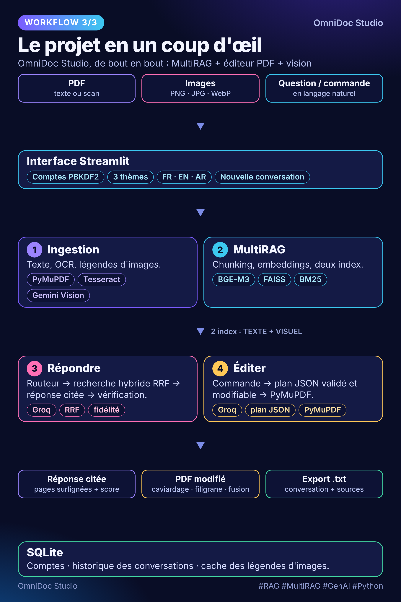
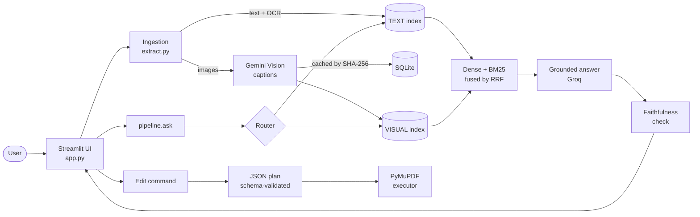

<div align="center">

# OmniDoc Studio

**Chat with your PDFs *and* images, then edit your PDFs in plain language.**
A multimodal, hybrid-retrieval RAG assistant with a safety-first PDF editor.

[](https://github.com/maitidles6557-lab/omnidoc-studio/actions/workflows/ci.yml)


[Français](README.fr.md) · [Architecture](docs/ARCHITECTURE.md) · [Contributing](CONTRIBUTING.md) · [Changelog](CHANGELOG.md)

</div>

---

## Why this project

Most RAG demos stop at "chunk, embed, ask". OmniDoc Studio goes further on the parts that make
document assistants trustworthy in practice:

- **It reads what a text-only pipeline misses**: scanned pages (OCR) and the *images inside* PDFs.
- **It retrieves better than dense search alone**: dense + lexical search fused with Reciprocal Rank Fusion.
- **It shows its work**: every answer cites its passages, highlighted on the original PDF page.
- **It checks itself**: a second LLM pass scores whether the answer is actually supported by the sources.
- **It edits documents without letting an LLM touch them directly**: natural language becomes a
  JSON plan that is schema-validated, user-editable, and only then executed.



## Features

| Capability | What it does |
|---|---|
| **MultiRAG** | Two indexes: **TEXT** (PDF text + OCR fallback) and **VISUAL** (image captions generated by Gemini Vision). |
| **Hybrid retrieval** | Dense (`BAAI/bge-m3` + FAISS) and lexical (accent-insensitive BM25), fused with Reciprocal Rank Fusion. |
| **Query router** | An LLM picks `text`, `visual` or `both` before searching (skipped when only one index exists). |
| **Image → PDF search** | An "active" image enriches the query, enabling cross-modal retrieval into your PDFs. |
| **Faithfulness check** | A second pass grades whether the answer is supported by the retrieved sources (and the active image). |
| **Visual citations** | Cited passages are highlighted on the original PDF page. |
| **Natural-language PDF editor** | "delete pages 2 to 4", "redact Dupont", "watermark DRAFT" → validated JSON plan → PyMuPDF. |
| **GDPR redaction** | Detects e-mail / IBAN / phone / national ID and **removes the underlying text**, not just a black box. |
| **Utilities** | PDF merge, smart summaries, `.txt` conversation export. |
| **UX** | Accounts (PBKDF2), history, 3 themes, FR / EN / AR interface. |

## Architecture



The full design, a request sequence diagram, and the reasoning behind each decision are in
**[docs/ARCHITECTURE.md](docs/ARCHITECTURE.md)**.

### Key engineering decisions

- **The LLM never edits a PDF.** It only proposes a plan. `core/plan.py` is a pure-Python
  validation layer that normalizes types and drops unknown operations or malformed arguments;
  `core/editor.py` then applies the plan and refuses destructive edge cases (e.g. a deletion that
  would empty the document).
- **Business logic is UI-independent.** `core/pipeline.py` has no Streamlit import, so the whole
  question → route → retrieve → answer → verify chain is unit-testable.
- **Graceful degradation everywhere.** Router fails → search both. Verifier fails → answer is still
  returned with an explicit "unavailable" verdict. FAISS missing → exact NumPy fallback.
  Caption cache unavailable → ingestion continues.
- **Resilient external calls.** Timeouts, retries with exponential backoff on *transient* errors only
  (429 / 5xx / timeout), and a typed `MissingAPIKeyError` instead of an obscure startup crash.
- **Retrieved text is treated as data, not instructions.** The answer prompt tells the model to ignore any
  instructions embedded in the documents, a basic prompt-injection guard.
- **Cost-aware.** Image captions are cached by `SHA-256 + model`, and embedded images are capped per PDF.

## Quick start

```bash
git clone https://github.com/maitidles6557-lab/omnidoc-studio.git
cd omnidoc-studio

python -m venv .venv && source .venv/bin/activate      # Windows: .venv\Scripts\activate
pip install -r requirements.txt

cp .streamlit/secrets.toml.example .streamlit/secrets.toml   # then add your keys
streamlit run app.py
```

You need a [Groq](https://console.groq.com) key (routing, answers, verification, edit commands)
and a [Gemini](https://aistudio.google.com) key (image captioning). Settings are read from
`st.secrets` **or** environment variables.

**OCR** (optional, recommended for scanned PDFs): install [Tesseract](https://github.com/tesseract-ocr/tesseract)
with the `fra`, `ara` and `eng` language packs. Use `TESSERACT_CMD` for a custom path.

### Docker

```bash
docker build -t omnidoc-studio .
docker run -p 8501:8501 -v omnidoc-data:/data \
  -e GROQ_API_KEY=... -e GEMINI_API_KEY=... omnidoc-studio
```

### Configuration

Everything is overridable without touching code. Common settings (full list in [`.env.example`](.env.example)):

| Variable | Default | Purpose |
|---|---|---|
| `GROQ_MODEL` | `openai/gpt-oss-20b` | Chat model (routing, answers, verification, edit plans) |
| `GEMINI_MODEL` | `gemini-3.6-flash` | Vision model for image captions |
| `EMBED_MODEL` | `BAAI/bge-m3` | Multilingual embedding model |
| `CHUNK_SIZE` / `CHUNK_OVERLAP` | `900` / `150` | Chunking |
| `MIN_DENSE_SCORE` | `0.25` | Cosine floor for dense-only hits |
| `RRF_K` | `60` | Reciprocal Rank Fusion constant |
| `MAX_PDF_IMAGES` | `12` | Images captioned per PDF (API cost cap) |
| `LLM_TIMEOUT_S` / `LLM_MAX_RETRIES` | `60` / `3` | Resilience of LLM calls |

## Development

```bash
make install     # runtime + dev dependencies
make test        # unit tests (offline: fake LLM + fake embedder, no API key needed)
make coverage    # tests with a coverage report
make lint        # ruff
make help        # all targets
```

The suite runs **fully offline**: LLM and embedder are replaced by deterministic fakes, so CI needs
neither API keys nor model downloads. PyMuPDF-dependent editor tests are skipped if it is not installed.

Optional: `pip install pre-commit && pre-commit install` to lint and scan for committed private keys on every commit.

## Project structure

```
app.py                 Streamlit UI (3 tabs: Assistant, PDF editor, Insights)
core/
  config.py            settings, secrets, paths, logging
  prompts.py           every prompt in one place
  i18n.py              UI strings (fr / en / ar)
  extract.py           PDF text, OCR fallback, embedded images
  retrieval.py         chunking, BM25, dense (FAISS / NumPy), RRF, MultiRAG
  llm.py               Gemini (vision) + Groq (routing, answers, verification, edit commands)
  pipeline.py          ask(): route -> search -> answer -> verify; cached image captioning
  plan.py              edit-plan validation (schema, types, bounds)
  pii.py               personal-data detection
  editor.py            PDF operations, redaction, citation rendering
  theme.py             dark / light / soft themes
  export.py            conversation .txt export
  db.py                accounts (PBKDF2), history, caption cache (SQLite)
tests/                 offline unit tests
docs/                  architecture, workflow diagrams, engineering notes
```

## Security notes

- API keys come from environment variables or `st.secrets`, never from code. `.env` and
  `.streamlit/secrets.toml` are git-ignored, and a test fails if a key-like string is committed.
- Passwords are hashed with PBKDF2-HMAC-SHA256 and a per-user random salt.
- Redaction removes the text under the mask, but it is regex-based: **always review the output**.

To report a vulnerability, see [SECURITY.md](SECURITY.md).

## Limitations & roadmap

**Known limitations**
- The search index is rebuilt on every "Build MultiRAG" and is not persisted to disk.
- PII redaction is regex-based (e-mail, IBAN, phone, national ID); it can miss unusual formats.
- Watermarks use PyMuPDF's default font, so non-Latin text (e.g. Arabic) does not render correctly there.
- At most 12 embedded images per PDF are captioned (`MAX_PDF_IMAGES`) to bound API cost.

**Ideas**
- Persist the index (FAISS on disk) and support incremental updates.
- Add a retrieval evaluation harness (hit-rate / MRR on a small labelled set).
- Optional cross-encoder reranking after fusion.

## License

MIT. See [LICENSE](LICENSE).
