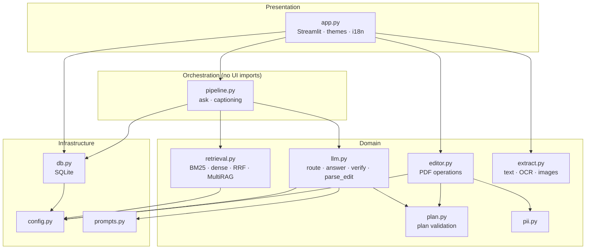
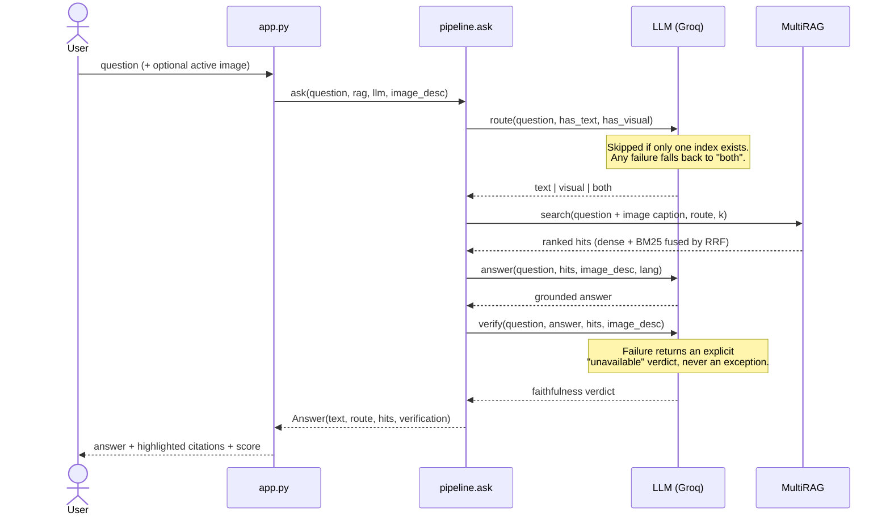
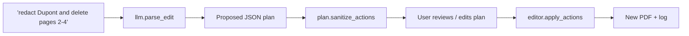

# Architecture

OmniDoc Studio is a Streamlit application on top of a UI-independent engine (`core/`).
This document explains how the pieces fit together and *why* they are built this way.

## Layers

Dependencies point downward only. `pipeline.py` never imports Streamlit, which is what makes the
core answering chain testable with a fake LLM and a fake embedder.

## Answering a question

## Hybrid retrieval

`HybridIndex` (in `core/retrieval.py`) runs two retrievers and fuses their *rankings*:

1. **Dense**: normalized `BAAI/bge-m3` embeddings, inner product through FAISS (exact NumPy fallback).
2. **Lexical**: a from-scratch BM25 with accent-insensitive tokenization.
3. **Fusion**: Reciprocal Rank Fusion, `score(d) = Σ 1 / (k + rank(d))`, with `k = 60` by default.
4. **Gate**: a dense hit below `MIN_DENSE_SCORE` is dropped unless BM25 also ranks it in its top-k.

`MultiRAG` owns two such indexes, TEXT and VISUAL, and queries them according to the route.
Visual hits request `max(2, k // 2)` results so images do not crowd out text passages.

### Why RRF instead of a weighted score sum?

Dense cosine similarities and BM25 scores live on unrelated scales. A weighted sum needs per-corpus
tuning and breaks when either distribution shifts. RRF only uses ranks, so it needs no calibration
and is robust to a retriever being weak on a given query (for example exact identifiers, where BM25
wins, versus paraphrases, where dense wins).

### Why a router?

Searching both indexes on every question dilutes context with irrelevant images or text. A cheap
classification step keeps the prompt focused. It is skipped when only one index exists and falls back
to `both` if the call fails, so it can only ever *improve* retrieval, never block it.

## Faithfulness verification

After generation, a second pass receives the question, the answer, and the retrieved passages
(plus the active image caption) and returns a structured verdict. It is a guardrail, not a proof:
an LLM judging an LLM can be wrong, so the verdict is shown to the user as a score next to the
citations rather than used to silently rewrite the answer.

## Natural-language PDF editing

The LLM output is treated as **untrusted input**:

- `plan.py` allows only a fixed set of operations (`delete_pages`, `keep_pages`, `rotate`, `reorder`,
  `watermark`, `redact`, `highlight`, `redact_pii`), coerces types, bounds ranges, rejects very short
  redaction terms (so "a" cannot blank a document) and caps watermark length.
- `editor.apply_actions` re-validates, checks page bounds against the actual document, and refuses a
  deletion that would empty it. It returns a human-readable log of what was and was not applied.
- Redaction removes the text under the mask rather than only drawing a rectangle over it.
- The user sees and can edit the plan *before* execution.

## Failure model

| Component fails | Behaviour |
|---|---|
| Router call | Search both indexes |
| Verifier call | Return the answer with an explicit "unavailable" verdict |
| FAISS not installed | Exact NumPy inner-product search (same results) |
| Caption cache (SQLite) | Log a warning, caption anyway |
| One image caption | Skip that image, continue ingestion |
| Transient LLM error (429 / 5xx / timeout) | Exponential backoff, then fail with the original error |
| Missing API key | `MissingAPIKeyError` with an actionable message |
| Password-protected PDF | Clear message; index build continues for other files |

## Testing strategy

- **Offline by construction.** `tests/conftest.py` provides a deterministic hashed bag-of-words
  `FakeEmbedder` and a fake LLM, so no network, API key or model download is needed.
- Tests cover retrieval (BM25, RRF, hybrid search, routing of the two indexes), the LLM wrapper
  (JSON extraction, retries, verdict normalization), plan validation, PII detection, the SQLite layer,
  export and themes, and the PDF editor (skipped if PyMuPDF is absent).
- A repository-hygiene test fails if a key-like string is committed.

## Possible next steps

- Persist the FAISS index and support incremental updates, instead of rebuilding on each run.
- A small labelled retrieval benchmark (hit-rate@k, MRR) to compare chunk sizes and fusion settings.
- Cross-encoder reranking on the fused top-N.
- Streaming answers in the UI.
